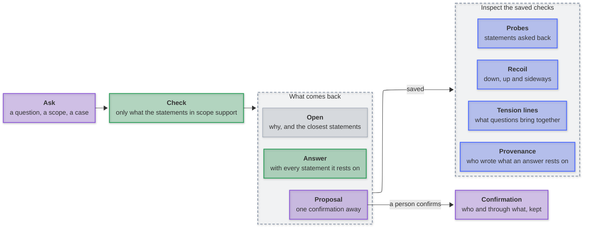

# Tendora

A terminal workbench for developing knowledge through natural language, with traceable reasoning across roles.

[](https://github.com/mirzahusadzic/tendora/actions/workflows/ci.yml)
[](https://nodejs.org/)
[](docs/setup.md)
[](THIRD_PARTY_NOTICES.md)

Write statements, organize them by role, and ask questions within a scope. A deterministic engine answers only what the statements support, names every statement an answer rests on, and keeps what they do not settle open.

**Research prototype.** Reading new text uses [eGemma](https://github.com/mirzahusadzic/egemma); everything after the reading runs locally. The bundled demo replays offline.

## How it works

**Key:** 🟣 people · ⚪ interfaces · 🟡 the one network service · 🔵 kept in the project · 🟢 deterministic.

```mermaid
---
config:
    layout: elk
    look: neo
    flowchart:
        wrappingWidth: 400
    themeCSS: >-
        foreignObject { overflow: visible; }
        .edgeLabel, .edgeLabel p, .edgeLabel span {
        background: transparent !important; }
        .edgeLabel rect { fill: transparent !important; }
        .labelBkg { --knock: var(--vscode-editor-background,
        var(--bgColor-default, rgb(from currentColor
        clamp(30, (128 - r) * 100, 255) clamp(30, (128 - r) * 100, 255)
        clamp(30, (128 - r) * 100, 255)))); --ring: var(--knock);
        --fill: color-mix(in srgb, var(--ring) 30%, var(--knock));
        background: var(--fill) !important; border-radius: 4px;
        box-shadow: 0 0 0 5px var(--fill), 0 0 0 7px var(--ring); }
        .label[data-id^="L_PE_"] .labelBkg { --ring: #8e5bd6; }
        .label[data-id^="L_IF_"] .labelBkg { --ring: #b5bcc6; }
        .label[data-id^="L_EG_"] .labelBkg { --ring: #e3a008; }
        .label[data-id^="L_PJ_"] .labelBkg { --ring: #4d6bfe; }
        .label[data-id^="L_EN_"] .labelBkg { --ring: #2e9e5b; }
        .edgeLabel p, .edgeLabel span, .edgeLabel text {
        --halo: var(--fill, var(--vscode-editor-background,
        var(--bgColor-default,
        rgb(from currentColor clamp(0, (128 - r) * 100, 255)
        clamp(0, (128 - r) * 100, 255) clamp(0, (128 - r) * 100, 255)))));
        text-shadow: 1px 0 var(--halo), -1px 0 var(--halo),
        0 1px var(--halo), 0 -1px var(--halo), 1px 1px var(--halo),
        -1px -1px var(--halo), 1px -1px var(--halo), -1px 1px var(--halo),
        0 0 3px var(--halo), 0 0 4px var(--halo); }
---
flowchart LR
    PE["<b>People</b><br/>write statements and ask, by role"]
    IF["<b>Workbench and CLI</b><br/>one engine behind both"]
    EG["<b>eGemma</b><br/>reads new text into AMR"]
    PJ["<b>Project</b><br/>statements by role, readings, saved checks"]
    EN["<b>Deterministic engine</b><br/>a grammar from the readings, a check in scope"]
    OUT["<b>Results</b><br/>answers with their sources, openings, proposals"]

    PE -->|"statements and questions"| IF
    IF -->|"text without a reading"| EG
    IF -->|"statements, their authors, questions"| PJ
    EG -->|"readings, kept with model and revision"| PJ
    PJ -->|"the statements in scope"| EN
    EN -->|"saved, exported with provenance"| OUT

    classDef default fill:#8a96a82e,stroke:#8a96a8,stroke-width:1px
    classDef person fill:#8e5bd64d,stroke:#8e5bd6,stroke-width:2px
    classDef interface fill:#ffffff40,stroke:#b5bcc6,stroke-width:2px
    classDef service fill:#e3a0084d,stroke:#e3a008,stroke-width:2px
    classDef kept fill:#4d6bfe4d,stroke:#4d6bfe,stroke-width:2px
    classDef engine fill:#2e9e5b4d,stroke:#2e9e5b,stroke-width:2px
    class PE person
    class IF interface
    class EG service
    class PJ kept
    class EN,OUT engine
```



<p align="center"><em>Text leaves the machine only to eGemma, for a reading or an embedding not yet retained; a check with <code>--offline</code> sends nothing. Comparison and ranking help navigate; only the engine answers.</em></p>

## What you can do



Everything here is in the [capability tour](docs/demo.md), on the bundled demo, with the graphs of each step. Inspection reads the saved checks and checks nothing again.

## Where it stands

It answers only what its sources support: answers stay attributed, unknowns stay open, and withdrawing a statement retracts only what depended on it. The open problem is questions worded independently of a domain's statements. Three held-out domains, two of them blind with a sealed answer key, first gave 0 of 18 warranted answers, kept all 5 unknowns open and supported nothing false. [Diagnosed](docs/held-out-diagnosis.md) and now development sets, they give none of the 18 by itself and propose the right connection for 4; reworded blind (46 questions), 1 of 34 with 5 more one confirmation away, all 9 unknowns open, nothing wrong. A claim about generalisation needs a new sealed domain (`node test/acceptance/independent-domain.mjs`).

## Start

Requires **Node.js 24+**, **[uv](https://docs.astral.sh/uv/)** and Git on macOS or Linux. Setup creates a local Python 3.14 environment.

```sh
git clone https://github.com/mirzahusadzic/tendora.git
cd tendora
npm ci
npm run setup:python
npm run demo                                          # a working copy of the demo
npm run workbench -- --project .proj/payments-demo
npx tendora ask --project .proj/payments-demo --offline \
  --question "Who notifies the customers?" --case-text "A certificate expires."
```

In the workbench, choose a role; `n` adds statements, `a` asks, `o` opens Development, where saved questions show their answer, what it rests on and what it brings together. `?` lists every key. [The CLI reference](docs/cli.md) covers every command.

## Performance

Trimming, the step that keeps only the facts a rule can still use before the engine joins, in JavaScript, Swift and Metal, each output byte-identical to a JavaScript oracle; captured from the bundled demo, so anyone can reproduce it ([bench/lean-core](bench/lean-core/README.md), Apple M5 Pro):

| Facts     | JavaScript | Swift, 1 thread | Swift, 18 threads | Metal (GPU) |
| --------- | ---------- | --------------- | ----------------- | ----------- |
| 141,768   | 20.0 ms    | 4.83 ms         | 0.80 ms           | 0.20 ms     |
| 567,072   | 292 ms     | 65.9 ms         | 6.27 ms           | 2.36 ms     |
| 9,073,152 | 13.8 s     | 3.14 s          | 394 ms            | 80.2 ms     |

Medians of three interleaved rounds; Metal is the faster of its two variants, GPU time. Native code is about 4× JavaScript on one thread; the GPU is about 5× all eighteen CPU threads at nine million facts here, and 2.2× on a corpus where far less survives the trim. The trim itself is the lever: the engine's join then sees only the facts its matches use.

## The name

Tendora comes from _tendon_, where load is carried and resistance felt: a question is pressed into a bounded check against scoped sources, and what cannot be supported stays visible as an opening.

## Stack

JavaScript ES modules · terminal-kit · SQLite / sqlite-vec · Python / PENMAN · [SEMCAT](https://github.com/mirzahusadzic/semcat) · [PropBank](vendor/propbank/README.md) · optional [Bolinas](https://github.com/mirzahusadzic/bolinas) cross-check (`npm run setup:bolinas`, `npm run check:research`)

[Demo tour](docs/demo.md) · [CLI](docs/cli.md) · [Setup](docs/setup.md) · [Architecture](docs/architecture.md) · [Development & CI](docs/development.md) · [Load-bearing meaning](load-bearing.md)

## License

Tendora's original code, tests, tools, documentation and payments demo are [MIT](LICENSE). Some parts carry other terms:

- `python/semcat/adapter/` is GPL-3.0-only; the SEMCAT runtime that setup installs is GPL-3.0-only AND MIT. Distributing Tendora integrated with SEMCAT must comply with GPLv3.
- `vendor/propbank/lexicon.json` is PropBank-derived data under CC BY-SA 4.0.
- [`load-bearing.md`](load-bearing.md) is CC BY 4.0.

See [licensing and attribution](THIRD_PARTY_NOTICES.md) for every path, installed component and notice.
