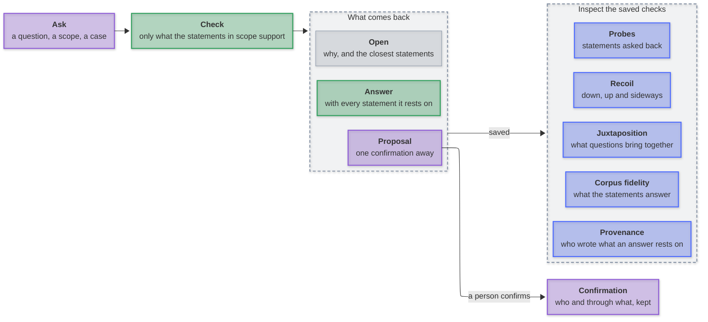

# Tendora

Knowledge as a corpus of plain-language statements, by role: it answers only what it supports, names the statements behind every answer, and keeps the rest open, so people and models can check it and build on it. Built and inspected in a terminal workbench.

[](https://github.com/mirzahusadzic/tendora/actions/workflows/ci.yml)
[](https://nodejs.org/)
[](docs/setup.md)
[](THIRD_PARTY_NOTICES.md)

Write statements, organize them by role, and ask questions within a scope. A deterministic engine answers only what the statements support, names every statement an answer rests on, and keeps what they do not settle open.

**Research prototype.** Reading new text uses [eGemma](https://github.com/mirzahusadzic/egemma); everything after the reading runs locally. The bundled demo replays offline.

## How it works

**Key:** 🟣 people · ⚪ interfaces · 🟡 the one network service · 🔵 kept in the project · 🟢 deterministic.

```mermaid
---
config:
    layout: elk
    look: neo
    flowchart:
        wrappingWidth: 220
    themeCSS: >-
        foreignObject { overflow: visible; }
        .edgeLabel, .edgeLabel p, .edgeLabel span {
        background: transparent !important; }
        .edgeLabel rect { fill: transparent !important; }
        .labelBkg { --knock: var(--vscode-editor-background,
        var(--bgColor-default, rgb(from currentColor
        clamp(30, (128 - r) * 100, 255) clamp(30, (128 - r) * 100, 255)
        clamp(30, (128 - r) * 100, 255)))); --ring: var(--knock);
        --fill: color-mix(in srgb, var(--ring) 30%, var(--knock));
        background: var(--fill) !important; border-radius: 4px;
        box-shadow: 0 0 0 5px var(--fill), 0 0 0 7px var(--ring); }
        .label[data-id^="L_IF_"] .labelBkg { --ring: #b5bcc6; }
        .label[data-id^="L_PJ_"] .labelBkg { --ring: #4d6bfe; }
        .edgeLabel p, .edgeLabel span, .edgeLabel text {
        --halo: var(--fill, var(--vscode-editor-background,
        var(--bgColor-default,
        rgb(from currentColor clamp(0, (128 - r) * 100, 255)
        clamp(0, (128 - r) * 100, 255) clamp(0, (128 - r) * 100, 255)))));
        text-shadow: 1px 0 var(--halo), -1px 0 var(--halo),
        0 1px var(--halo), 0 -1px var(--halo), 1px 1px var(--halo),
        -1px -1px var(--halo), 1px -1px var(--halo), -1px 1px var(--halo),
        0 0 3px var(--halo), 0 0 4px var(--halo); }
---
flowchart LR
    PE["<b>People</b><br/>write statements and ask, by role"]
    IF["<b>Workbench and CLI</b><br/>one engine behind both"]
    EG["<b>eGemma</b><br/>reads new text into AMR"]
    PJ["<b>Project</b><br/>statements by role, readings, saved checks"]
    EN["<b>Deterministic engine</b><br/>answers with their sources, openings and proposals, saved with provenance"]

    PE --> IF
    IF <-->|"new text, its reading"| EG
    IF -->|"statements, readings"| PJ
    PJ -->|"statements in scope"| EN

    classDef default fill:#8a96a82e,stroke:#8a96a8,stroke-width:1px
    classDef person fill:#8e5bd64d,stroke:#8e5bd6,stroke-width:2px
    classDef interface fill:#ffffff40,stroke:#b5bcc6,stroke-width:2px
    classDef service fill:#e3a0084d,stroke:#e3a008,stroke-width:2px
    classDef kept fill:#4d6bfe4d,stroke:#4d6bfe,stroke-width:2px
    classDef engine fill:#2e9e5b4d,stroke:#2e9e5b,stroke-width:2px
    class PE person
    class IF interface
    class EG service
    class PJ kept
    class EN engine
```



<p align="center"><em>Text leaves the machine only to eGemma, for a reading or an embedding not yet retained; a check with <code>--offline</code> sends nothing. Comparison and ranking help navigate; only the engine answers.</em></p>

## What you can do



<p align="center"><em>Everything here is in the <a href="docs/demo.md">capability tour</a>, on the bundled demo, with the graphs of each step. Inspection reads the saved checks and checks nothing again.</em></p>

## Capabilities

| Capability          | What it gives                                                                                                                                   | CLI                         | Workbench                    | Tour                                                            |
| ------------------- | ----------------------------------------------------------------------------------------------------------------------------------------------- | --------------------------- | ---------------------------- | --------------------------------------------------------------- |
| Question and answer | An answer with every statement and rule it rests on; conditional, ambiguous or open, and why                                                    | `ask`                       | `a`                          | [1](docs/demo.md#1-a-question-and-its-answer)                   |
| Case                | The circumstances of one check; an answer that rests on them says so                                                                            | `ask --case-text`           | the ask form                 | [1](docs/demo.md#1-a-question-and-its-answer)                   |
| Read in, and said   | "Must" answers "should", a pronoun, one modal word: each answer read that way says so                                                           | `ask`                       | the answer                   | [2](docs/demo.md#2-what-the-engine-reads-in)                    |
| Proposal            | A connection one confirmation away, never read in by itself; the confirmation records who                                                       | `ask`                       | `d` in Development           | [3](docs/demo.md#3-open-and-why)                                |
| Juxtaposition       | Where questions bring the role tree's branches together: resolved, gathered or open                                                             | `tensions`                  | a role with children         | [4](docs/demo.md#4-juxtaposition-what-questions-bring-together) |
| Recoil              | From a statement, role or question: what it rests on, what rests on it, what shares its place                                                   | `recoil`                    | question and statement views | [5](docs/demo.md#5-recoil-down-up-and-sideways)                 |
| Probes              | Each statement asked back from its own reading                                                                                                  | `probe`                     | a statement                  | [6](docs/demo.md#6-asked-back-from-its-own-reading)             |
| Corpus fidelity     | What the statements can be asked back for, what questions rest on; with withholding, the [load-bearing](docs/load-bearing.md) test per variable | `fidelity`                  | the root role                | [7](docs/demo.md#7-corpus-fidelity)                             |
| Provenance          | Who wrote each statement an answer rests on, kept with the check                                                                                | `ask --json`, `show --json` | a statement                  | [8](docs/demo.md#8-who-wrote-what)                              |
| Saved checks        | Every check kept with its evidence; said when the statements changed since                                                                      | `runs`, `show`, `delete`    | `o` Development              | [CLI](docs/cli.md)                                              |

## Where it stands

It answers only what its sources support: answers stay attributed, unknowns stay open, and withdrawing a statement retracts only what depended on it. The open problem is questions worded independently of a domain's statements ([where they are lost](docs/held-out-diagnosis.md)):

| Held-out questions                         | Answered | One confirmation away | Unknowns kept open | Wrong |
| ------------------------------------------ | -------- | --------------------- | ------------------ | ----- |
| Three domains, two blind with a sealed key | 0 of 18  | 4                     | 5 of 5             | 0     |
| The same, reworded blind (46 questions)    | 1 of 34  | 5                     | 9 of 9             | 0     |

A claim about generalisation needs a new sealed domain (`node test/acceptance/independent-domain.mjs`).

## Start

Requires **Node.js 24+**, **[uv](https://docs.astral.sh/uv/)** and Git on macOS or Linux. Setup creates a local Python 3.14 environment.

```sh
git clone https://github.com/mirzahusadzic/tendora.git
cd tendora
npm ci
npm run setup:python
npm run demo                                          # a working copy of the demo; -- --reset renews it
npm run workbench -- --project .proj/payments-demo
npx tendora ask --project .proj/payments-demo --offline \
  --question "Who notifies the customers?" --case-text "A certificate expires."
```

In the workbench, choose a role; `n` adds statements, `a` asks, `o` opens Development, where saved questions show their answer, what it rests on and what it brings together. `?` lists every key. [The CLI reference](docs/cli.md) covers every command.

## Performance

Trimming keeps only the facts a rule can still use, before the engine joins, as John Tromp's [Cuckoo Cycle](https://github.com/tromp/cuckoo) trims a graph's edges before its cycle search. In JavaScript, Swift and Metal, every output byte-identical to a JavaScript oracle, on captures of the bundled demo that anyone can reproduce ([bench/lean-core](bench/lean-core/README.md), Apple M5 Pro). The engine trims every inference round this way, in JavaScript by default: on the demo and a 210-statement corpus its inference is identical and 16 to 31% faster. `--backend` runs it in Swift or Metal where the machine has them ([trim backends](docs/cli.md#trim-backends)); that pays above about 250,000 facts, beyond the 48,000 a check's inference is bounded at today.

Time, the median of three interleaved rounds (Metal: the faster of its two variants, GPU time):

| Facts     | JavaScript | Swift, 1 thread | Swift, 18 threads | Metal (GPU) |
| --------- | ---------- | --------------- | ----------------- | ----------- |
| 141,768   | 20.0 ms    | 4.83 ms         | 0.80 ms           | 0.20 ms     |
| 567,072   | 292 ms     | 65.9 ms         | 6.27 ms           | 2.36 ms     |
| 9,073,152 | 13.8 s     | 3.14 s          | 394 ms            | 80.2 ms     |

Peak memory, the process's physical footprint as macOS counts it (runtime, inputs, index and working memory):

| Facts     | JavaScript | Swift, 1 thread | Swift, 18 threads | Metal (GPU) |
| --------- | ---------- | --------------- | ----------------- | ----------- |
| 141,768   | 46 MB      | 5.1 MB          | 6.2 MB            | 106 MB      |
| 567,072   | 99 MB      | 14 MB           | 18 MB             | 211 MB      |
| 9,073,152 | 570 MB     | 171 MB          | 217 MB            | 2.0 GB      |

- Native code is about 4× JavaScript on one thread. The GPU is about 5× all eighteen CPU threads at nine million facts, and 2.2× on a corpus where far less survives the trim.
- The GPU pays in memory: about 100 MB of Metal runtime, a domain bitset over every term for each rule in flight, and a pool for the kept lists (0.84 and 0.93 GB at nine million facts). JavaScript reads the store's columns into its heap; Swift maps them from the capture.
- The trim itself is the lever: the engine's join then sees only the facts its matches use.

## The name

Tendora comes from _tendon_, where load is carried and resistance felt: a question is pressed into a bounded check against scoped sources, and what cannot be supported stays visible as an opening.

## Stack

JavaScript ES modules · terminal-kit · SQLite / sqlite-vec · Python / PENMAN · [SEMCAT](https://github.com/mirzahusadzic/semcat) · [PropBank](vendor/propbank/README.md) · optional [Bolinas](https://github.com/mirzahusadzic/bolinas) cross-check (`npm run setup:bolinas`, `npm run check:research`)

[Demo tour](docs/demo.md) · [CLI](docs/cli.md) · [Setup](docs/setup.md) · [Architecture](docs/architecture.md) · [Storage](docs/storage.md) · [Development & CI](docs/development.md) · [Load-bearing as situated meaning](docs/load-bearing.md) · [Contributing](CONTRIBUTING.md) · [Security](SECURITY.md)

## License

Tendora's original code, tests, tools, documentation and payments demo are [MIT](LICENSE). Some parts carry other terms:

- `python/semcat/adapter/` is GPL-3.0-only; the SEMCAT runtime that setup installs is GPL-3.0-only AND MIT. Distributing Tendora integrated with SEMCAT must comply with GPLv3.
- `vendor/propbank/lexicon.json` is PropBank-derived data under CC BY-SA 4.0.
- The essay [Load-bearing as situated meaning](docs/load-bearing.md) is CC BY 4.0.

See [licensing and attribution](THIRD_PARTY_NOTICES.md) for every path, installed component and notice.
