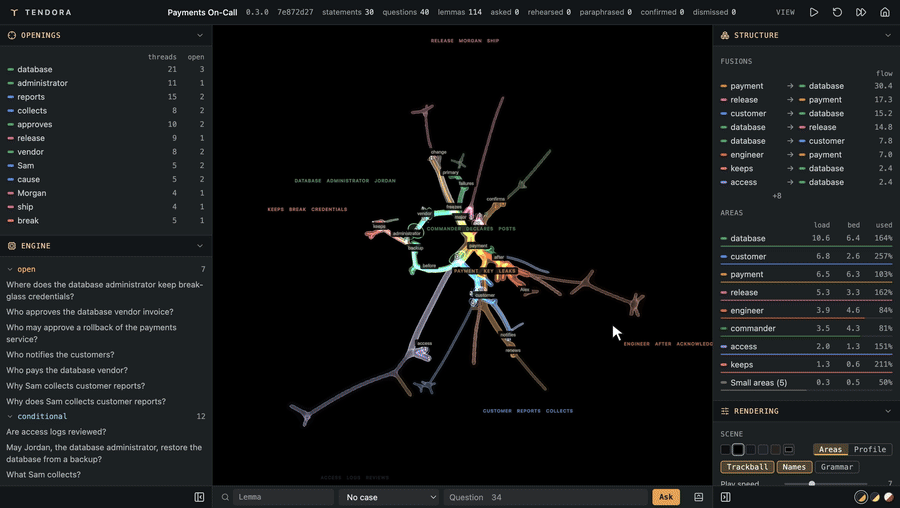

# Tendora

[](https://github.com/mirzahusadzic/tendora/actions/workflows/ci.yml)
[](dist/LICENSE)
[](licenses/Apache-2.0.txt)
[](https://nodejs.org/)
[](#try-it)
[](https://doi.org/10.5281/zenodo.24094773)

Tendora answers questions from a corpus of plain-language statements, organized by role: it answers only what the statements support, names every statement an answer rests on, and keeps the rest open.

- **Cited answers:** every answer names the statements it rests on.
- **Open, never guessed:** what the statements do not settle stays open, with the reason and the closest statements.
- **A person confirms:** a connection the engine proposes counts only once someone accepts it.
- **Deterministic and fast:** the same corpus and question give the same answer, in a fraction of a second.
- **Audited:** [Gadfly](https://github.com/mirzahusadzic/gadfly) cuts what an answer cites and checks that the answer moves.

This repository is Tendora's public demo: the engine, bundled, with a payments on-call corpus to run it on, and the evidence of what its answers rest on. The engine and its editor are developed privately.

## Try it

Requires **Node.js 24+** on macOS or Linux.

```sh
git clone https://github.com/mirzahusadzic/tendora.git
cd tendora
npm install
npm run demo
npm run workbench -- --project .proj/payments-demo
```

In the workbench, choose a role; `o` opens Development, where each saved question shows its answer, what it rests on and what it brings together; `?` lists every key.

| To | Run |
| -- | --- |
| Serve the engine for Gadfly | `npm run serve -- --project .proj/payments-demo --port 8791 --offline` |
| Ask questions yourself (once: [uv](https://docs.astral.sh/uv/)) | `npm run setup:python`, then `npx tendora ask --project .proj/payments-demo --offline --question "Who notifies the customers?" --case-text "A certificate expires."` |
| Ask brand-new questions | run [eGemma](https://github.com/mirzahusadzic/egemma) on this machine (it reads new text into meaning graphs); Tendora finds it at `http://127.0.0.1:8000`, or set `EGEMMA_URL` for another. Give Tendora eGemma's key (its `WORKBENCH_API_KEY`) with `EGEMMA_API_KEY` or `EGEMMA_API_KEY_FILE`, and drop `--offline` |

The demo's saved answers and the workbench need no Python and no network; Gadfly's battery needs only Gadfly, which `uvx` fetches, with its own Python, on first use. `npm run setup:python` installs PENMAN and SEMCAT, which a new question is prepared and compared with ([notices](THIRD_PARTY_NOTICES.md)).

## How it works

**Key:** 🟣 people · ⚪ interfaces · 🟡 the one network service · 🔵 kept in the project · 🟢 deterministic.

```mermaid
---
config:
    layout: elk
    look: neo
    themeVariables:
        fontFamily: '-apple-system, BlinkMacSystemFont, "Segoe UI", "Noto Sans", Helvetica, Arial, sans-serif'
    flowchart:
        wrappingWidth: 220
        padding: 20
    themeCSS: >-
        foreignObject { overflow: visible; }
        .node foreignObject, .node foreignObject *, .edgeLabel, .edgeLabel * {
        font-family: -apple-system, BlinkMacSystemFont, "Segoe UI", "Noto Sans", Helvetica, Arial, sans-serif !important; line-height: 1.5 !important; }
        .node foreignObject, .node foreignObject * { white-space: nowrap !important; }
        .edgeLabel, .edgeLabel p, .edgeLabel span {
        background: transparent !important; }
        .edgeLabel rect { fill: transparent !important; }
        .labelBkg { --knock: var(--vscode-editor-background,
        var(--bgColor-default, rgb(from currentColor
        clamp(30, (128 - r) * 100, 255) clamp(30, (128 - r) * 100, 255)
        clamp(30, (128 - r) * 100, 255)))); --ring: var(--knock);
        --fill: color-mix(in srgb, var(--ring) 30%, var(--knock));
        background: var(--fill) !important; border-radius: 4px;
        box-shadow: 0 0 0 5px var(--fill), 0 0 0 7px var(--ring); }
        .label[data-id^="L_IF_"] .labelBkg { --ring: #b5bcc6; }
        .label[data-id^="L_PJ_"] .labelBkg { --ring: #4d6bfe; }
        .edgeLabel p, .edgeLabel span, .edgeLabel text {
        --halo: var(--fill, var(--vscode-editor-background,
        var(--bgColor-default,
        rgb(from currentColor clamp(0, (128 - r) * 100, 255)
        clamp(0, (128 - r) * 100, 255) clamp(0, (128 - r) * 100, 255)))));
        text-shadow: 1px 0 var(--halo), -1px 0 var(--halo),
        0 1px var(--halo), 0 -1px var(--halo), 1px 1px var(--halo),
        -1px -1px var(--halo), 1px -1px var(--halo), -1px 1px var(--halo),
        0 0 3px var(--halo), 0 0 4px var(--halo); }
---
flowchart LR
    PE["<b>People</b><br/>write statements and ask, by role"]
    IF["<b>Workbench and CLI</b><br/>one engine behind both"]
    EG["<b>eGemma</b><br/>reads new text into AMR"]
    PJ["<b>Project</b><br/>statements by role,<br/>readings, saved checks"]
    EN["<b>Deterministic engine</b><br/>answers with their sources,<br/>openings and proposals,<br/>saved with provenance"]

    PE --> IF
    IF <-->|"new text, its reading"| EG
    IF -->|"statements, readings"| PJ
    PJ -->|"statements in scope"| EN

    classDef default fill:#8a96a82e,stroke:#8a96a8,stroke-width:1px
    classDef person fill:#8e5bd64d,stroke:#8e5bd6,stroke-width:2px
    classDef interface fill:#ffffff40,stroke:#b5bcc6,stroke-width:2px
    classDef service fill:#e3a0084d,stroke:#e3a008,stroke-width:2px
    classDef kept fill:#4d6bfe4d,stroke:#4d6bfe,stroke-width:2px
    classDef engine fill:#2e9e5b4d,stroke:#2e9e5b,stroke-width:2px
    class PE person
    class IF interface
    class EG service
    class PJ kept
    class EN engine
```



<p align="center"><em>Text leaves the machine only to eGemma, for a reading or an embedding not yet retained; a check with <code>--offline</code> sends nothing. Comparison and ranking help navigate; only the engine answers.</em></p>

## Run Gadfly's battery

Gadfly's tendora battery asks the running engine each of the 31 questions again with the cited statements cut, other statements cut at random, the material reordered and a control removed, and reads a verdict from what moved. Serve the demo on port 8791 (the frames name that address, so it is fixed), then in a second terminal:

```sh
mkdir -p runs
for f in evidence/payments-demo/frames/tendora-*.json; do
  n=$(basename "$f" .json)
  uvx --from 'midwife==0.6.0' gadfly run "$f" \
    --battery midwife.batteries.tendora:Tendora \
    --out "runs/$n.jsonl" --calls 7
  uvx --from 'midwife==0.6.0' gadfly report "$f" "runs/$n.jsonl"
done
```

Each frame plans 6 or 7 calls, 190 in all. Gadfly never writes over records, so start each run with an empty `runs/` folder.

## Evidence

The same 31 questions, read by Tendora's engine and by Gemma 4 (26B-A4B, instruction-tuned) served by eGemma:

| Reader                         | Carried     | Unresolved | Misaligned | Cooled |
| ------------------------------ | ----------- | ---------- | ---------- | ------ |
| Tendora (deterministic engine) | **31 / 31** | 0          | 0          | 0      |
| Gemma 4, temperature 0.7       | 10 / 31     | 18         | 1          | 2      |
| Gemma 4, temperature 0         | 14 / 31     | 11         | 3          | 3      |

An answer is **carried** when cutting its cited statements moves it, and the repeat, the random cuts and the reordering do not. These frames declare neither of Gadfly's two further checks, so both stay open in every report: a bypass trial (with all the material withheld, the reader should say it cannot answer rather than fall back on something hidden) and a presentation trial (a one-to-one renaming of the material should leave the answer as it is). At temperature 0.7 the read shows how steadily Gemma answers; at temperature 0 its repeats agree by construction, and the read shows whether a cut moves its answer. Sixteen questions are carried by Tendora and by neither Gemma read. [The evidence](docs/evidence.md) has every question, each reader's answer and verdict, and how a verdict is read.

Every frame, record and report is kept in [evidence/payments-demo](evidence/payments-demo) (Gemma at temperature 0 in its `gemma-temperature-0/` folder), and Gadfly recomputes any verdict from them with no engine, model or network:

```sh
uvx --from 'midwife>=0.5.0' gadfly report \
  evidence/payments-demo/frames/tendora-are-access-logs-reviewed-2a9de24f.json \
  evidence/payments-demo/runs/tendora-are-access-logs-reviewed-2a9de24f.jsonl
```

## The editor

A domain's statements become a corpus Tendora answers from through corpus development: the statements are situated by role, every connection the engine proposes is accepted by a person, and Gadfly's trials audit what each answer rests on. That work happens in Tendora's editor, which is developed privately and not released.

<p align="center"><a href="docs/editor-demo.md"></a></p>
<p align="center"><em>The editor on this repository's payments demo: play, areas, branches and a fusion, a lemma, one question a rule decides, then the same question left open where two rules collide, and at the end a small GPT's layers beside the corpus. <a href="docs/editor-demo.md">What the video shows</a>.</em></p>

## The essay

[Load-bearing as situated meaning](docs/load-bearing.md) says when a statement can be called load-bearing for an answer, and what has to be shown first. Its accounting helper ([tools/support/load-bearing.mjs](tools/support/load-bearing.mjs)) and offline test ([test/acceptance/load-bearing.mjs](test/acceptance/load-bearing.mjs)) run with Node alone.

## The name

Tendora comes from _tendon_, where load is carried and resistance felt: a question is pressed into a bounded check against scoped sources, and what cannot be supported stays visible as an opening.

## Cite

The working paper on Zenodo describes how Tendora renders a corpus as a river, and tests which of its shapes the corpus makes and which the drawing rules make. The paper is under CC BY 4.0; its DOI always resolves to its latest version:

```bibtex
@misc{husadzic2026river,
  author    = {Husadzic, Mirza},
  title     = {The River and Its Rules: Rendering a Corpus's
               Co-activation and Testing What It Makes},
  year      = {2026},
  publisher = {Zenodo},
  note      = {Working paper},
  doi       = {10.5281/zenodo.24094773},
  url       = {https://doi.org/10.5281/zenodo.24094773}
}
```

## License

The engine bundle in `dist/` is under the [Tendora Demo Engine License](dist/LICENSE): run it, unmodified, to evaluate, demo and research; it may not be redistributed, reverse engineered or offered as a hosted service. The payments corpus (`demo/`), the evidence, the documents and the essay's helper are under the [Apache License 2.0](licenses/Apache-2.0.txt) (with its [NOTICE](NOTICE)); the essay is under [CC BY 4.0](licenses/CC-BY-4.0.txt); the PropBank-derived lexicon under CC BY-SA 4.0. [Licensing and third-party notices](THIRD_PARTY_NOTICES.md) lists every part.

[Evidence](docs/evidence.md) · [The payments demo](docs/payments-demo.md) · [The editor demo](docs/editor-demo.md) · [Essay](docs/load-bearing.md) · [Security](SECURITY.md) · [Citation](CITATION.cff) · [Notices](THIRD_PARTY_NOTICES.md) · [Licenses](LICENSE)
