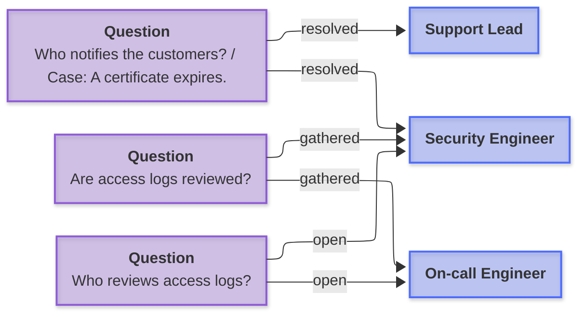
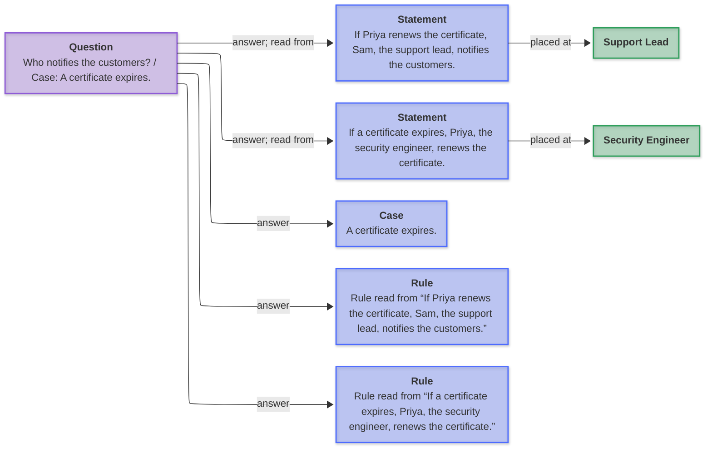
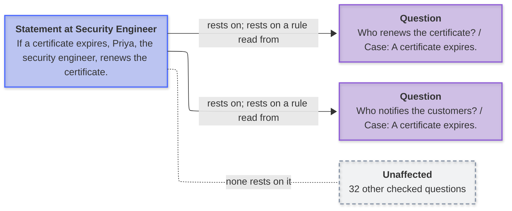
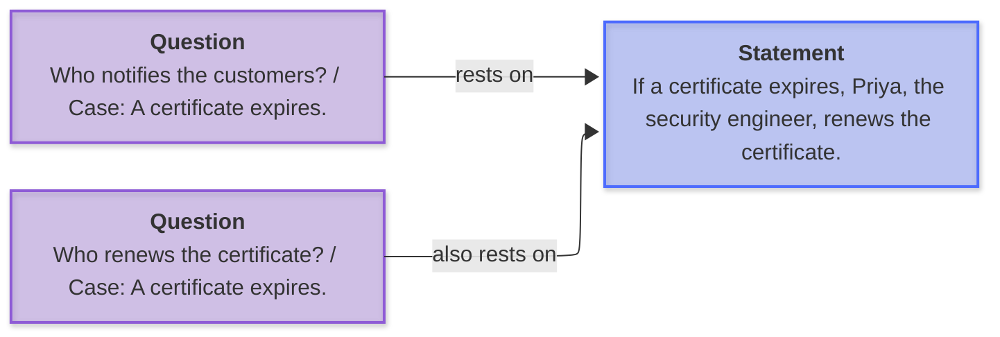

# The demo: a capability tour

**Payments On-Call** is an incident-response team in six roles: an Incident
Commander over an on-call engineer, a release manager, a support lead, a
database administrator and a security engineer. It holds 25 statements and 36
saved questions with their answers and evidence, prebuilt: the whole tour
replays offline, and `test/acceptance/demo-tour.mjs` checks every step.

```sh
npm run demo -- --reset                              # the demo, in .proj/payments-demo
npm run workbench -- --project .proj/payments-demo   # or the CLI below
```

Every command runs as shown from the checkout, after the two lines above;
outputs are trimmed (`…`). `--reset` renews a copy made from an older demo, and
replaces nothing that is not a copy of the demo. `npm link` puts `tendora` on your PATH, without `npx`.

## 1. A question and its answer

A question is checked against the statements in its scope. A case states the
circumstances of one check: rules apply to it and an answer may rest on it,
saying so, but it never becomes a statement. Here two rules in two roles chain:

```
$ npx tendora ask --project .proj/payments-demo --offline \
    --question "Who notifies the customers?" --case-text "A certificate expires."
supported: Who notifies the customers? (case: A certificate expires.)
Answer: Sam
  rests on the case and 2 statements
Saved as …
```

<!-- graph: question-and-answer -->



```mermaid
---
config:
    layout: elk
    look: neo
    flowchart:
        wrappingWidth: 240
    themeCSS: >-
        foreignObject { overflow: visible; }
        .edgeLabel, .edgeLabel p, .edgeLabel span {
        background: transparent !important; }
        .edgeLabel rect { fill: transparent !important; }
        .labelBkg { --knock: var(--vscode-editor-background,
        var(--bgColor-default, rgb(from currentColor
        clamp(30, (128 - r) * 100, 255) clamp(30, (128 - r) * 100, 255)
        clamp(30, (128 - r) * 100, 255)))); --ring: var(--knock);
        --fill: color-mix(in srgb, var(--ring) 30%, var(--knock));
        background: var(--fill) !important; border-radius: 4px;
        box-shadow: 0 0 0 5px var(--fill), 0 0 0 7px var(--ring); }
        .label[data-id^="L_Q_"] .labelBkg { --ring: #8e5bd6; }
        .label[data-id^="L_C_"] .labelBkg { --ring: #4d6bfe; }
        .label[data-id^="L_S1_"] .labelBkg { --ring: #4d6bfe; }
        .label[data-id^="L_S2_"] .labelBkg { --ring: #2e9e5b; }
        .edgeLabel p, .edgeLabel span, .edgeLabel text {
        --halo: var(--fill, var(--vscode-editor-background,
        var(--bgColor-default,
        rgb(from currentColor clamp(0, (128 - r) * 100, 255)
        clamp(0, (128 - r) * 100, 255) clamp(0, (128 - r) * 100, 255)))));
        text-shadow: 1px 0 var(--halo), -1px 0 var(--halo),
        0 1px var(--halo), 0 -1px var(--halo), 1px 1px var(--halo),
        -1px -1px var(--halo), 1px -1px var(--halo), -1px 1px var(--halo),
        0 0 3px var(--halo), 0 0 4px var(--halo); }
---
flowchart LR
    Q["<b>Question</b><br/>Who notifies the customers? (at Incident Commander)"]
    C["<b>Case</b><br/>A certificate expires."]
    S1["<b>Security Engineer</b><br/>If a certificate expires, Priya, the security engineer, renews the certificate."]
    S2["<b>Support Lead</b><br/>If Priya renews the certificate, Sam, the support lead, notifies the customers."]
    A["<b>Answer: Sam</b><br/>supported; rests on 2 statements, 2 rules and the case"]

    Q -->|"asks for the conclusion of"| S2
    C -->|"meets the condition of"| S1
    S1 -->|"its conclusion meets the condition of"| S2
    S2 -->|"concludes"| A
    class Q person
    class C,S1 kept
    class S2,A engine
    classDef default fill:#8a96a82e,stroke:#8a96a8,stroke-width:1px
    classDef person fill:#8e5bd64d,stroke:#8e5bd6,stroke-width:2px
    classDef kept fill:#4d6bfe4d,stroke:#4d6bfe,stroke-width:2px
    classDef engine fill:#2e9e5b4d,stroke:#2e9e5b,stroke-width:2px
    classDef open fill:#8a96a814,stroke:#8a96a8,stroke-width:2px,stroke-dasharray:6 4
```

Without the case the rules have nothing to apply to, and the question stays
open. Asked at `--scope "Release Manager"`, "Who approves the database vendor
invoice?" is open too: the statement that answers it is the Incident
Commander's, outside that scope.

## 2. What the engine reads in

| Question                                                      | Answer                                                                   |
| ------------------------------------------------------------- | ------------------------------------------------------------------------ |
| Who freezes changes during a major incident?                  | Morgan, through the kind statement "A deployment is a change."           |
| Does Morgan ship a release? (case: A major incident is open.) | No: a negated conclusion under its condition                             |
| Does Jordan test a backup before restoring it?                | Yes, `Read "it" as the backup the question names.`                       |
| Who should rotate a leaked payment key?                       | Priya, `A source says it must be done; that answers "should".`           |
| Who may fail over the primary database?                       | Jordan, conditional: after the on-call engineer confirms replication lag |

A kind statement extends one way: what is a change is not thereby a
deployment. Each step that read the question says how.

## 3. Open, and why

```
$ npx tendora ask --project .proj/payments-demo --offline \
    --question "Who may approve a rollback of the payments service?"
open: Who may approve a rollback of the payments service?
Why it stays open: A statement says “rollback of the payments service” too, but the two were read differently.
Proposal: Maya, one confirmation away (in the workbench: Development, d)
  from: Maya, the incident commander, may approve a rollback of the payments service.
Closest statements (none answers it):
  Maya, the incident commander, may approve a rollback of the payments service.
…
```

A proposal answers only once a person confirms it; the confirmation records who
and through what. "Who pays the database vendor?" names its closest statements;
"Which engineer acknowledges every page within ten minutes?" stays open, since
the statement says five; "Who reviews access logs?" has two answers (Alex and
Priya) and stays ambiguous: the engine does not choose.

## 4. Juxtaposition: what questions bring together

`tensions` reads, over the latest check of each question, scope and case,
which branches of the role tree a question's answer draws on:

```
$ npx tendora tensions --project .proj/payments-demo
Of 36 checked questions, 3 bring roles together, 28 stay in one role and 5 cite no statement.

On-call Engineer ↔ Security Engineer
  gathered (each gives its own answer): Are access logs reviewed?
  open (reached, not yet answered): Who reviews access logs?

Support Lead ↔ Security Engineer
  resolved (one answer composes both): Who notifies the customers?
```

<!-- graph: juxtaposition -->



An open line is a place to ask or to author, never an answer.

## 5. Recoil: down, up and sideways

Recoil walks the saved checks from a question, a statement or a role; it
acquires nothing and saves nothing.

**Down**, what an answer rests on:

```
$ npx tendora recoil --project .proj/payments-demo \
    --question "Who notifies the customers?" --case-text "A certificate expires."
```

<!-- graph: recoil-down -->



**Up**, what rests on a statement:

```
$ npx tendora recoil --project .proj/payments-demo --statement "If a certificate expires"
```

<!-- graph: recoil-up -->



**Sideways**, other questions resting on the same statements (from the same
question as down):

<!-- graph: recoil-sideways -->



What the walk cannot see (a check made against earlier statements, a released
one, a question never checked) is its frontier, never absence. In the demo every
check is current, so there is none.

## 6. Asked back from its own reading

```
$ npx tendora probe --project .proj/payments-demo --statement "If a certificate expires"
If a certificate expires, Priya, the security engineer, renews the certificate.  [Security Engineer]
  who or what: If a certificate expires, ___ renews the certificate.
    recovered: Priya
  what: If a certificate expires, Priya, the security engineer, renews the ___.
    recovered: certificate
…
3 recovered.
```

A probe leaves one participant blank and asks the statement back from its
reading; one the engine cannot recover is a reading to reword.

## 7. Corpus fidelity

Every statement asked back for each of its variables (participants,
circumstances, truth), and every checked question classed by what it rests on:

```
$ npx tendora fidelity --project .proj/payments-demo
Corpus fidelity at revision …

25 statements (25 read), 85 variables asked back
  answerable 81 (95%): own 81, shared 0, carried 0
  silent 3, possible 0, otherwise 0, owed 1, conflict 0
  settled 24 of 25; questions rest on 18 of 25

36 checked questions: one statement 14, composed 3 (across roles 2),
  conditional 11, possible 1, composition met 0, open 7
…
To review:
  Sam, the support lead, must not promise a recovery time before the on-call engineer identifies the cause.  [Support Lead]
    owed: must do what
```

| A variable is                       | When                                                                                |
| ----------------------------------- | ----------------------------------------------------------------------------------- |
| own, shared, carried (answerable)   | its own statement answers it alone, or others answer it the same, or only others do |
| silent                              | rightly unanswered: its condition is not given, or it is a necessary condition      |
| possible, otherwise, owed, conflict | to review: one of several answers, a different answer, no answer, or both ways      |

`--withhold` asks each answerable variable again without its statement: here
all 81 are borne alone, so no statement's content is carried twice (the
[load-bearing](load-bearing.md) test, per variable). The workbench shows the
same at the root role, by itself up to 300 statements.

## 8. Who wrote what

```
$ npx tendora ask --project .proj/payments-demo --offline --actor Dana --json \
    --question "Who notifies the customers?" --case-text "A certificate expires." \
    | jq -c '.provenance.statements[] | [.kind // "statement", .author, .via]'
["statement","Claude","library"]
["statement","Claude","library"]
["case","Dana","cli"]
```

The six statements written for this tour record their author (through the
library); the original nineteen predate recorded authorship and say
`unrecorded`. A case is the check's, so it names who made the check. Each check
keeps this as it stood when it ran. Authorship is declared, not verified.

## In the workbench

Open Development (`o`) and select a saved question: below its answer and
evidence come **What the answer rests on**, **Other questions resting on the
same statements** and **Juxtaposition: what it brings together**. Select a statement there (`Enter`)
for **What rests on it**, **Asked back from its reading** and **Written by**. A
role with children shows **Juxtaposition: tension lines**. A proposal is confirmed with
`d` on the question.
