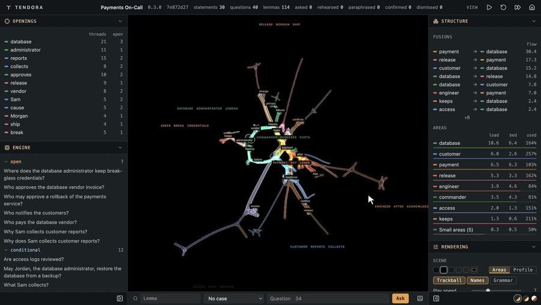

# The editor demo

<p align="center"><a href="media/tendora-editor-demo.mp4"></a></p>

Corpus development happens in Tendora's editor: statements are situated by role, the scene shows where each question runs through the corpus and where the corpus leaves it open, and the engine answers at any place picked. The editor is developed privately and is not in this repository. The video shows it on the [payments demo](payments-demo.md) this repository ships, and every answer in it comes from the same engine as `npm run demo`. [The video at full resolution](media/tendora-editor-demo.mp4) is an MP4.

## What the video shows

| Step | On screen | What it shows |
| ---- | --------- | ------------- |
| 1. Play | Play is pressed; when the last question is in, the scene is turned and zoomed by hand. | The lemmas of the statements as branches, coloured by area, and each question run in turn as a thread of light through the lemmas it brings together. |
| 2. Areas | The area _release_ is picked under Structure, the pointer rests on the branch _ship_, then the area _database_ is picked. | Openings and Engine narrow to the area's lemmas: each lemma's threads and open questions, and the questions asked there, by status. |
| 3. Branches | The branches _freezes_ and _certificate_ are clicked in the scene. | Each click opens its lemma: Engine lists the questions asked at it, by status. |
| 4. A fusion | The fusion _payment → database_ is picked, and the scene turned again. | The two areas and the streams of questions that run between them. |
| 5. A lemma | _Morgan_ is typed in the lemma search. | Morgan's threads light up, and Engine lists the questions asked at Morgan. |
| 6. A rule decides | _Does Morgan ship a release?_ is asked in the case _A major incident is open._ | **Supported: No.** The answer rests on the case and on "If a major incident is open, Morgan, the release manager, does not ship a release." |
| 7. Two rules collide | The same question is asked in the case _A major incident is open, and a payment key leaks._ | **Conflict.** The candidate Yes rests on "If a payment key leaks, Morgan, the release manager, ships a release.", the candidate No on the rule of step 6. The engine shows both, with the closest statements, and picks neither. |
| 8. The model | Superposition is switched on under Model: nanoGPT layer 1, then layer 4. | Where a small transformer trained on the demo's statements alone (nanoGPT, Andrej Karpathy's design) puts each lemma, drawn as grey spheres beside the branches the corpus's relations give. |

## Ask the same questions

The answers of steps 6 and 7 come from the engine in this repository. After `npm run demo` and, once, `npm run setup:python`:

```sh
npx tendora ask --project .proj/payments-demo --offline \
  --question "Does Morgan ship a release?" \
  --case-text "A major incident is open."
npx tendora ask --project .proj/payments-demo --offline \
  --question "Does Morgan ship a release?" \
  --case-text "A major incident is open, and a payment key leaks."
```

```text
supported: Does Morgan ship a release? (case: A major incident is open.)
Answer: No
  rests on the case and 1 statement
…
conflict: Does Morgan ship a release? (case: A major incident is open, and a payment key leaks.)
Candidate: Yes
  rests on the case and 1 statement
Candidate: No
  rests on the case and 1 statement
…
Closest statements (none answers it):
  If a major incident is open, Morgan, the release manager, does not ship a release.
  If a payment key leaks, Morgan, the release manager, ships a release.
  Morgan, the release manager, freezes deployments during a major incident.
```
